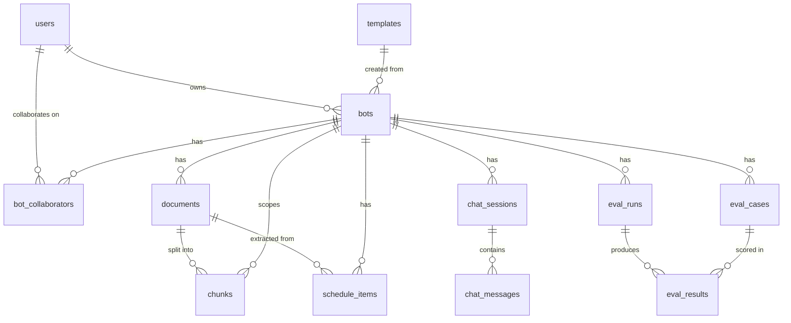

# Syllabot Platform — Database Schema

PostgreSQL 16 with the `pgvector` extension. All primary keys are UUIDs. Every table holding course content carries `bot_id`, which is the tenant boundary.

## 1. Entity relationship diagram



## 2. Setup

```sql
CREATE EXTENSION IF NOT EXISTS vector;
CREATE EXTENSION IF NOT EXISTS pgcrypto;   -- gen_random_uuid()
CREATE EXTENSION IF NOT EXISTS citext;     -- case-insensitive email

CREATE TYPE user_role       AS ENUM ('admin', 'instructor');
CREATE TYPE bot_status      AS ENUM ('draft', 'published', 'archived');
CREATE TYPE collab_level    AS ENUM ('editor', 'viewer');
CREATE TYPE doc_status      AS ENUM ('uploaded', 'processing', 'ready', 'failed');
CREATE TYPE doc_source      AS ENUM ('file', 'url');
CREATE TYPE schedule_kind   AS ENUM ('assignment', 'exam', 'quiz', 'project', 'reading', 'holiday', 'other');
CREATE TYPE message_role    AS ENUM ('user', 'assistant');
CREATE TYPE eval_verdict    AS ENUM ('pass', 'partial', 'fail', 'error');
CREATE TYPE run_status      AS ENUM ('queued', 'running', 'completed', 'failed');
```

Students are anonymous in v1, so they have no `users` row; they are tracked by `chat_sessions`.

## 3. Tables

### 3.1 users
```sql
CREATE TABLE users (
    id             UUID PRIMARY KEY DEFAULT gen_random_uuid(),
    email          CITEXT NOT NULL UNIQUE,
    password_hash  TEXT NOT NULL,
    full_name      TEXT NOT NULL,
    role           user_role NOT NULL DEFAULT 'instructor',
    is_active      BOOLEAN NOT NULL DEFAULT TRUE,
    created_at     TIMESTAMPTZ NOT NULL DEFAULT now(),
    updated_at     TIMESTAMPTZ NOT NULL DEFAULT now()
);
```

### 3.2 templates
```sql
CREATE TABLE templates (
    id                   UUID PRIMARY KEY DEFAULT gen_random_uuid(),
    name                 TEXT NOT NULL UNIQUE,          -- e.g. 'Syllabus Assistant'
    description          TEXT,
    system_prompt        TEXT NOT NULL,
    default_model        TEXT NOT NULL,                 -- e.g. 'gpt-4o-mini'
    default_settings     JSONB NOT NULL DEFAULT '{}',   -- temperature, top_k, threshold
    welcome_message      TEXT,
    suggested_questions  TEXT[] NOT NULL DEFAULT '{}',
    fallback_message     TEXT NOT NULL,
    is_active            BOOLEAN NOT NULL DEFAULT TRUE,
    created_by           UUID REFERENCES users(id) ON DELETE SET NULL,
    created_at           TIMESTAMPTZ NOT NULL DEFAULT now(),
    updated_at           TIMESTAMPTZ NOT NULL DEFAULT now()
);
```

### 3.3 bots
Template values are copied in at creation; `template_id` only records origin.
```sql
CREATE TABLE bots (
    id                   UUID PRIMARY KEY DEFAULT gen_random_uuid(),
    owner_id             UUID NOT NULL REFERENCES users(id) ON DELETE CASCADE,
    template_id          UUID REFERENCES templates(id) ON DELETE SET NULL,
    course_name          TEXT NOT NULL,
    course_code          TEXT,
    term                 TEXT,                           -- e.g. 'Fall 2026'
    timezone             TEXT NOT NULL DEFAULT 'America/Phoenix',
    system_prompt        TEXT NOT NULL,
    model                TEXT NOT NULL,
    settings             JSONB NOT NULL DEFAULT '{}',    -- {"temperature":0.2,"top_k":6,"min_score":0.35}
    welcome_message      TEXT,
    suggested_questions  TEXT[] NOT NULL DEFAULT '{}',
    fallback_message     TEXT NOT NULL,
    contact_info         TEXT,                           -- shown in fallback replies
    status               bot_status NOT NULL DEFAULT 'draft',
    share_slug           TEXT NOT NULL UNIQUE,           -- random, e.g. 10 chars base62
    require_login        BOOLEAN NOT NULL DEFAULT FALSE,
    rate_limit_per_min   INT NOT NULL DEFAULT 20,
    published_at         TIMESTAMPTZ,
    created_at           TIMESTAMPTZ NOT NULL DEFAULT now(),
    updated_at           TIMESTAMPTZ NOT NULL DEFAULT now()
);
CREATE INDEX idx_bots_owner ON bots(owner_id);
```

### 3.4 bot_collaborators
```sql
CREATE TABLE bot_collaborators (
    bot_id      UUID NOT NULL REFERENCES bots(id) ON DELETE CASCADE,
    user_id     UUID NOT NULL REFERENCES users(id) ON DELETE CASCADE,
    level       collab_level NOT NULL DEFAULT 'editor',
    added_at    TIMESTAMPTZ NOT NULL DEFAULT now(),
    PRIMARY KEY (bot_id, user_id)
);
CREATE INDEX idx_collab_user ON bot_collaborators(user_id);
```

### 3.5 documents
```sql
CREATE TABLE documents (
    id             UUID PRIMARY KEY DEFAULT gen_random_uuid(),
    bot_id         UUID NOT NULL REFERENCES bots(id) ON DELETE CASCADE,
    source_type    doc_source NOT NULL DEFAULT 'file',
    filename       TEXT,                 -- original name (file sources)
    source_url     TEXT,                 -- url sources
    storage_key    TEXT,                 -- path / S3 key, random
    mime_type      TEXT,
    size_bytes     BIGINT,
    content_hash   TEXT,                 -- sha256, to skip re-processing identical files
    status         doc_status NOT NULL DEFAULT 'uploaded',
    error_message  TEXT,
    page_count     INT,
    chunk_count    INT NOT NULL DEFAULT 0,
    uploaded_by    UUID REFERENCES users(id) ON DELETE SET NULL,
    created_at     TIMESTAMPTZ NOT NULL DEFAULT now(),
    processed_at   TIMESTAMPTZ,
    CHECK (
      (source_type = 'file' AND storage_key IS NOT NULL) OR
      (source_type = 'url'  AND source_url  IS NOT NULL)
    )
);
CREATE INDEX idx_documents_bot ON documents(bot_id);
```

### 3.6 chunks
Embedding dimension depends on the model: 1536 for `text-embedding-3-small`, 384 for `bge-small-en`. Pick one per deployment; changing it requires re-embedding.
```sql
CREATE TABLE chunks (
    id             UUID PRIMARY KEY DEFAULT gen_random_uuid(),
    bot_id         UUID NOT NULL REFERENCES bots(id) ON DELETE CASCADE,
    document_id    UUID NOT NULL REFERENCES documents(id) ON DELETE CASCADE,
    chunk_index    INT NOT NULL,                 -- order within document
    section_title  TEXT,
    page_start     INT,
    page_end       INT,
    content        TEXT NOT NULL,
    token_count    INT NOT NULL,
    embedding      VECTOR(1536) NOT NULL,
    embedding_model TEXT NOT NULL,
    created_at     TIMESTAMPTZ NOT NULL DEFAULT now(),
    UNIQUE (document_id, chunk_index)
);

CREATE INDEX idx_chunks_bot ON chunks(bot_id);
CREATE INDEX idx_chunks_embedding ON chunks
    USING hnsw (embedding vector_cosine_ops);

-- Optional keyword search for hybrid retrieval
ALTER TABLE chunks ADD COLUMN tsv tsvector
    GENERATED ALWAYS AS (to_tsvector('english', coalesce(section_title,'') || ' ' || content)) STORED;
CREATE INDEX idx_chunks_tsv ON chunks USING gin(tsv);
```

### 3.7 schedule_items
```sql
CREATE TABLE schedule_items (
    id            UUID PRIMARY KEY DEFAULT gen_random_uuid(),
    bot_id        UUID NOT NULL REFERENCES bots(id) ON DELETE CASCADE,
    document_id   UUID REFERENCES documents(id) ON DELETE CASCADE,  -- NULL if added manually
    title         TEXT NOT NULL,                -- 'Midterm Exam'
    kind          schedule_kind NOT NULL DEFAULT 'other',
    starts_at     TIMESTAMPTZ,
    due_at        TIMESTAMPTZ,
    all_day       BOOLEAN NOT NULL DEFAULT TRUE,
    location      TEXT,
    notes         TEXT,
    source_chunk_id UUID REFERENCES chunks(id) ON DELETE SET NULL,
    verified      BOOLEAN NOT NULL DEFAULT FALSE,  -- instructor confirmed
    created_at    TIMESTAMPTZ NOT NULL DEFAULT now(),
    updated_at    TIMESTAMPTZ NOT NULL DEFAULT now(),
    CHECK (starts_at IS NOT NULL OR due_at IS NOT NULL)
);
CREATE INDEX idx_schedule_bot_due ON schedule_items(bot_id, due_at);
```

### 3.8 chat_sessions
```sql
CREATE TABLE chat_sessions (
    id             UUID PRIMARY KEY DEFAULT gen_random_uuid(),
    bot_id         UUID NOT NULL REFERENCES bots(id) ON DELETE CASCADE,
    is_preview     BOOLEAN NOT NULL DEFAULT FALSE,  -- instructor testing, excluded from analytics
    client_hash    TEXT,                            -- hashed IP + user agent, no raw PII
    started_at     TIMESTAMPTZ NOT NULL DEFAULT now(),
    last_active_at TIMESTAMPTZ NOT NULL DEFAULT now()
);
CREATE INDEX idx_sessions_bot_time ON chat_sessions(bot_id, started_at);
```

### 3.9 chat_messages
`bot_id` is duplicated from the session for fast analytics queries.
```sql
CREATE TABLE chat_messages (
    id                  UUID PRIMARY KEY DEFAULT gen_random_uuid(),
    session_id          UUID NOT NULL REFERENCES chat_sessions(id) ON DELETE CASCADE,
    bot_id              UUID NOT NULL REFERENCES bots(id) ON DELETE CASCADE,
    role                message_role NOT NULL,
    content             TEXT NOT NULL,
    -- assistant-only fields
    retrieved_chunk_ids UUID[],
    top_score           REAL,
    used_schedule       BOOLEAN,
    is_fallback         BOOLEAN NOT NULL DEFAULT FALSE,
    model               TEXT,
    prompt_tokens       INT,
    completion_tokens   INT,
    latency_ms          INT,
    feedback            SMALLINT CHECK (feedback IN (-1, 1)),   -- thumbs down / up
    created_at          TIMESTAMPTZ NOT NULL DEFAULT now()
);
CREATE INDEX idx_messages_session ON chat_messages(session_id, created_at);
CREATE INDEX idx_messages_bot_time ON chat_messages(bot_id, created_at);
CREATE INDEX idx_messages_bot_fallback ON chat_messages(bot_id) WHERE is_fallback;
```

### 3.10 eval_cases
```sql
CREATE TABLE eval_cases (
    id               UUID PRIMARY KEY DEFAULT gen_random_uuid(),
    bot_id           UUID NOT NULL REFERENCES bots(id) ON DELETE CASCADE,
    question         TEXT NOT NULL,
    expected_answer  TEXT NOT NULL,
    expect_fallback  BOOLEAN NOT NULL DEFAULT FALSE,  -- for "should say I don't know" cases
    created_by       UUID REFERENCES users(id) ON DELETE SET NULL,
    created_at       TIMESTAMPTZ NOT NULL DEFAULT now()
);
CREATE INDEX idx_eval_cases_bot ON eval_cases(bot_id);
```

### 3.11 eval_runs and eval_results
```sql
CREATE TABLE eval_runs (
    id            UUID PRIMARY KEY DEFAULT gen_random_uuid(),
    bot_id        UUID NOT NULL REFERENCES bots(id) ON DELETE CASCADE,
    status        run_status NOT NULL DEFAULT 'queued',
    model         TEXT NOT NULL,
    total         INT NOT NULL DEFAULT 0,
    passed        INT NOT NULL DEFAULT 0,
    partial       INT NOT NULL DEFAULT 0,
    failed        INT NOT NULL DEFAULT 0,
    triggered_by  UUID REFERENCES users(id) ON DELETE SET NULL,
    started_at    TIMESTAMPTZ,
    finished_at   TIMESTAMPTZ,
    created_at    TIMESTAMPTZ NOT NULL DEFAULT now()
);
CREATE INDEX idx_eval_runs_bot ON eval_runs(bot_id, created_at DESC);

CREATE TABLE eval_results (
    id                  UUID PRIMARY KEY DEFAULT gen_random_uuid(),
    run_id              UUID NOT NULL REFERENCES eval_runs(id) ON DELETE CASCADE,
    case_id             UUID NOT NULL REFERENCES eval_cases(id) ON DELETE CASCADE,
    actual_answer       TEXT,
    verdict             eval_verdict NOT NULL,
    judge_reason        TEXT,
    retrieved_chunk_ids UUID[],
    latency_ms          INT,
    UNIQUE (run_id, case_id)
);
```

## 4. Key queries

### 4.1 Retrieval (always scoped by bot)
```sql
SELECT id, section_title, page_start, content,
       1 - (embedding <=> :query_embedding) AS score
FROM chunks
WHERE bot_id = :bot_id
ORDER BY embedding <=> :query_embedding
LIMIT :top_k;
```
For small bots Postgres may skip the HNSW index and scan the `bot_id` rows directly, which is fine at this size. If many large bots share the table, consider `SET hnsw.iterative_scan = relaxed_order` (pgvector 0.8+) or partitioning `chunks` by `bot_id`.

### 4.2 Upcoming schedule items
```sql
SELECT title, kind, due_at, starts_at, location
FROM schedule_items
WHERE bot_id = :bot_id
  AND coalesce(due_at, starts_at) >= now()
ORDER BY coalesce(due_at, starts_at)
LIMIT 10;
```

### 4.3 Analytics: fallback rate per day
```sql
SELECT date_trunc('day', m.created_at) AS day,
       count(*)                                   AS answers,
       count(*) FILTER (WHERE m.is_fallback)      AS fallbacks
FROM chat_messages m
JOIN chat_sessions s ON s.id = m.session_id
WHERE m.bot_id = :bot_id
  AND m.role = 'assistant'
  AND NOT s.is_preview
  AND m.created_at >= now() - interval '30 days'
GROUP BY 1
ORDER BY 1;
```

## 5. Rules and conventions
- **Tenant boundary:** any query on `chunks`, `schedule_items`, `chat_messages` or `eval_*` must filter by `bot_id`. Enforced in the service layer and covered by tests.
- **Cascades:** deleting a bot removes all of its documents, chunks, schedules, sessions and evals. Deleting a document removes its chunks and extracted schedule items.
- **Timestamps:** stored as `TIMESTAMPTZ` (UTC); converted with `bots.timezone` for display and for relative questions like "this week".
- **`updated_at`:** maintained by an `ON UPDATE` trigger or in the ORM.
- **Migrations:** managed with Alembic; the `vector` extension is created in the first migration.
- **Retention:** a nightly job deletes `chat_sessions` older than the retention period (default 180 days).

## 6. Optional: row-level security
As a second layer behind the service-layer checks:
```sql
ALTER TABLE chunks ENABLE ROW LEVEL SECURITY;
CREATE POLICY chunks_by_bot ON chunks
    USING (bot_id = current_setting('app.current_bot_id')::uuid);
```
The API sets `SET LOCAL app.current_bot_id = '<id>'` at the start of each request's transaction.
